  

&nbsp;&nbsp;
&nbsp;&nbsp;

---

## 👨‍💻 Sobre mim

Estudante de Ciência da Computação na FIAP e Gestão Comercial na Descomplica, com foco em Business Intelligence (BI), Análise de Dados e Inteligência de Negócios. Interesse em transformar dados em insights estratégicos, desenvolver dashboards, acompanhar indicadores de desempenho (KPIs) e apoiar a tomada de decisões orientadas por dados. Busco integrar competências analíticas, conhecimento tecnológico e visão de negócios para identificar oportunidades, otimizar processos e gerar valor para as organizações.

---

## 🛠️ Ferramentas e Tecnologias

### 📈 Dados & BI

<table>
  <tr>
    <td align="center" width="92">
       
      <b>Power BI</b>
    </td>
    <td align="center" width="92">
       
      <b>Excel</b>
    </td>
    <td align="center" width="92">
       
      <b>Python</b>
    </td>
    <td align="center" width="92">
       
      <b>Pandas</b>
    </td>
    <td align="center" width="92">
       
      <b>SQL</b>
    </td>
    <td align="center" width="92">
       
      <b>Jupyter</b>
    </td>
  </tr>
</table>

### 🌐 Desenvolvimento & Automação

<table>
  <tr>
    <td align="center" width="92">
       
      <b>JavaScript</b>
    </td>
    <td align="center" width="92">
       
      <b>TypeScript</b>
    </td>
    <td align="center" width="92">
       
      <b>HubSpot</b>
    </td>
  </tr>
</table>

---

## 🎓 Formação

<table>
  <tr>
    <td align="center" width="300">
       
      <b>FIAP</b> 
      Ciência da Computação 
      Em andamento
    </td>
    <td align="center" width="300">
       
      <b>Descomplica</b> 
      Gestão Comercial 
      Em andamento
    </td>
  </tr>
</table>

<!--
Cursos e certificações de dados: preencha com o que você realmente concluiu.
Exemplo de linha:
- 📊 Nome do curso: instituição, ano
-->

---

## 📊 Estatísticas do GitHub

 

<!--
Ative estes dois blocos quando tiver repositórios públicos com código e mais atividade:

-->

---

### 📬 Vamos conversar?

&nbsp;&nbsp;
&nbsp;&nbsp;

